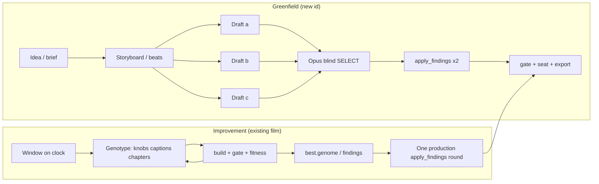
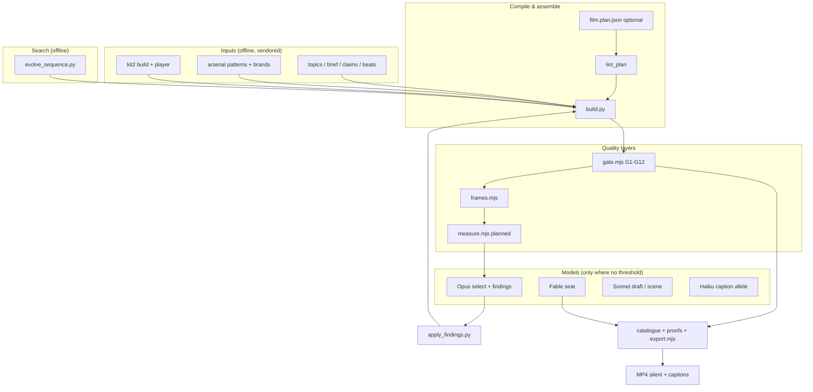
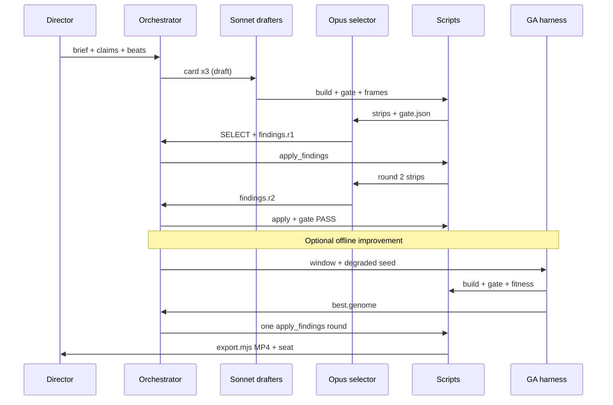

# Video pipeline plan · idea → final product

**Status:** forward architecture · branch `cursor/video-pipeline-plan-b921` · 2026-10-15  
**Audience:** orchestrators (Fable), implementers, and agents wiring Atelier + factory + arsenal.  
**Binding context:** `CLAUDE.md`, `docs/DECISIONS.md` (D1–D16, Q1–Q15), `factory/FORMAT.md`, `factory/PIPELINE.md`, `skills/ATELIER.md`.

This document maps the **seven stages** a director names in conversation to **artifacts that already exist**, then proposes where **blind selection** (proven) and **search / GA / reward** (pilot only) belong, and a **Phase 0–3** build order with acceptance that includes **visible MP4 deltas** and **gate PASS**.

---

## 1. Stage map (your language → repo artifacts)

| Stage | What it means in ceti-explainer | Primary artifacts | Skills / tools | Gate / proof |
|---|---|---|---|---|
| **Idea** | Topic, audience, verifiable numbers, format tier | `factory/topics/<id>/brief.md`, optional research in `factory/research/` | `atelier-brief`, `new_topic.py`, `repo_topic.py` | Claims exist with formula or source; beat order chosen (D11 commit on/off) |
| **Prompts** | Typed agent instructions + hashed inputs (swarm cards) | `skills/atelier-*/SKILL.md`, `references/*`, future `card.json` (`docs/SWARM-DESIGN.md`) | Orchestrator fills `agent-briefs.md` slots | Card audit: worker read only listed inputs |
| **Storyboard** | Beat sheet + module chain intent (pedagogy before pixels) | `factory/topics/<id>/beats.md`; **planned:** `film.plan.json` + generated `STORYBOARD.md` (`library/plan/METHOD.md` S0–S10) | `atelier-brief` (chain), METHOD tables T1–T12 / A1–A12 | `lint_plan` (L1–L13) when plan path is used |
| **Shot sequence** | Clock windows, chapters, caption spine, key times | `film.json`: `dur`, `chapters[]`, `captions[]`, optional `cuts[]` (D15), `beat` (D16) | Timeline: `arsenal/core/timeline.js`; compile from plan or hand-author | G4 format, G7 counts-first, G12 rhythm (WARN) |
| **Transitions** | Joins between beats/scenes; camera carry; morph hand-offs | `film.json` `cuts`; chapter `t0` shifts; module `morph` / `contrast-split` params in plan; gl-post `cutClamp` | `apply_findings.py` (chapter ≤ 2 s); future scene contracts (SWARM enter/exit poses) | G11 overlap; P8 cuts (`measure.mjs`, planned) |
| **Animation** | Pure `render(t, state)` + knobs | `film.js`, `lib/*`, copied `arsenal/patterns/*/pattern.js`; `film.json` `knobs` + `knobs_doc` | `factory/kit2/build.py`, `--brand`, `--chrome`, `--material`, `renderer: webgl` | G1–G3 purity/clock, G5 claims, G6 legibility, G8–G9 |
| **Final product** | Gated page + catalogue + optional MP4 | `build/<id>.<brand>.<chrome>.html` (D10), `gate.json`, `frames/`, `seat.json`, `MEASURES.md` | `gate.mjs`, `frames.mjs`, `catalogue.py`, `arsenal/tools/export.mjs` (D15 accum), `tests/proofs.sh` | G1–G12 PASS (G11 legacy: `--overlap-warn` per D13); MP4 silent, captions burned |

**Two production modes** (same stages, different emphasis):

| Mode | When | Creative search | Mechanical search |
|---|---|---|---|
| **Greenfield generation** | New topic / new film id | DRAFT ×3 → blind SELECT (Opus) | Scripts: build, gate, strip; optional plan `lint_plan` |
| **Video improvement** | Shipped or draft film with gate PASS | Opus findings rounds (≤ 2) + seat | GA on **bounded window** over knobs/captions/chapters; `tune.py` / G12 rules (planned) |

---

## 2. Typed contracts between stages

Contracts are **JSON or markdown on disk**; the orchestrator passes **paths + sha256** (SWARM-DESIGN), never “read the repo.”

### 2.1 Boundary table

```text
Idea          →  Prompts        brief.md + claims.json + beats.md
Prompts       →  Storyboard     same + filled slots in card.json / agent brief
Storyboard    →  Shot sequence  film.plan.json (future) OR beats.md → film.json chapters/captions skeleton
Shot sequence →  Transitions    film.json chapters + cuts[] + compiled key moments T[]
Transitions   →  Animation      scene contracts (future) OR whole film.js + knobs_doc
Animation     →  Final          built page + gate.json + frames.json + export.json
Improvement   →  Animation      findings.rN.json | evolve/best.genome.json (knob/caption/chapter only)
Final         →  Ship           seat.json, MEASURES.md, baselines hash, artefact URL
```

### 2.2 Core schemas (existing)

| Contract | Location | Consumer |
|---|---|---|
| Topic package | `factory/topics/<id>/{brief.md, claims.json, beats.md}` | Drafters, brief writer |
| Film definition | `film.json` + `claims.json` | kit2 `build.py`, gate, export |
| Renderer | `film.js` → `window.FILM_RENDER = { setup, render }` | Player, export sub-frames (D15) |
| Evaluator levers | `findings.rN.json` → `apply_findings.py` | Sonnet fix rounds; GA → findings-shaped export |
| Blind rank | `SELECT.md` + promoted `film.json` | Production winner; GA seed population |
| Quality floor | `gate.json` rows G1–G12 | Scripts; GA fitness hard constraint |
| Quality ceiling | `seat.json` (`craft`, `truth[]`, defects) | Fable ship/veto (D5); optional GA term ≤ 20 % |
| Phenotype log | `frames/frames.json` (0.5 s thumbs) | Opus select; future `measure.mjs` |
| Plan algebra | `film.plan.json` (`library/plan/BUILD-SPEC.md`) | `lint_plan`, future scene compiler |

### 2.3 Planned schemas (Phase 1–2)

| Contract | Purpose |
|---|---|
| `run/contract/scenes/sK.json` | Window `[t0,t1]`, enter/exit poses, knob prefix, claims slice, captions slice (SWARM-DESIGN) |
| `film.plan.json` | Module chain with params; generates beat windows and caption skeleton (METHOD S9) |
| `ceti.sequence_genome/v1` | GA genes: knobs + captions + chapters in `[t0,t1]` (`docs/GA-STORYBOARD-REWARD.md`, branch `cursor/ga-storyboard-reward-b921`) |
| `measures.json` | Rubric P1–P22 + gate-derived scores (`docs/SWARM-DESIGN.md` §2) |

**Laws on every boundary:** silent film (Q3); every digit traceable to `claims.json` (G5); no runtime fetches; `render(t, state)` pure with fixed seed; exec level = ink only (Q6, D14); CETI card last (Q8).

---

## 3. Human and model roles

| Role | Model / human | Owns | Must not |
|---|---|---|---|
| **Director (Fable)** | Human or Fable agent | Topic choice, wave brief, ship/veto, NOTES warnings | Edit film.js in fix rounds; bypass gate FAIL |
| **Orchestrator** | Script + policy | Branch, cards, build/gate/export DAG, commit per lane | Run git inside subagents |
| **Brief / research** | Sonnet (+ Haiku for claim lines) | `factory/topics/*`, research digests | Invent unsourced numbers |
| **Planner** | Opus (once per film) | `film.plan.json` or beats→knobs_doc intent; scene contract graph | Write per-frame code |
| **Drafter** | Sonnet × N parallel | One draft dir each: full `film.js` + knob surface | Read other drafts |
| **Selector / judge** | Opus blind | `SELECT.md`, `findings.r1/r2.json` from strips + captions + claims | Read `film.js` |
| **Fixer** | Sonnet + `apply_findings.py` | Apply findings; one self-fix in draft | Change beat order or claims |
| **Seat** | Fable blind | `seat.json` SHIP / REVISE / VETO | See code |
| **Script tier** | 0 tokens | build, gate, frames, export, fitness, `lint_plan`, future `measure.mjs` | Subjective rank |
| **GA harness** | Script (`evolve_sequence.py`) | Offline populations under `evolve/` | Write shipped `film.json` in place (pilot rule) |

Routing matches `HANDOFF.md` §8 and `factory/PIPELINE.md`: **Opus judges and selects; Sonnet drafts and fixes; scripts decide thresholds.**

---

## 4. Where selection beats search (default)

**Proven:** Atelier **DRAFT ×3 → blind SELECT → FIX ×2 → SHIP** on simpsons-3d, Wave GL trio, AI-STORIES, NOETHER (`PROTOTYPE.md`, `MEASURES.md`). Opus picked draft **c** (claim-carrying picture) over prettier alternatives—this is not recoverable from scalar gate fitness alone.

Use **selection** when:

- Competing **qualitatively different** render paths (architectural vs exhibit vs instrument registers).
- **Taste, truth legibility, originality** (seat rubric).
- **First ship** of a new id (explore discrete draft space, not local knob hill-climb).

Use **search / GA** only when:

- The **structure is fixed** (same `film.js`, same claims) and the defect class is **timing / sync / caption landing** (simpsons findings; goodhart COUNT window).
- You have a **degraded baseline** or **non-shipped draft** to beat—see §5.1 (simpsons lesson).

Do **not** expect GA to improve an already-shipped elite on knob-only fitness: the GA pilot found **best = shipped** for simpsons-3d `[36, 58]` s (identical MP4s). That is success of anchoring, not failure of machinery.

---

## 5. Where GA / reward belongs

### 5.1 Stage placement



| Pipeline stage | GA in v0/v1? | Genotype | Fitness (reward) |
|---|---|---|---|
| Idea / storyboard | No | — | — |
| Shot sequence | **v1** (chapter `t0`) | chapter genes ± 2 s | G4, G12, alignment |
| Captions | **v1** | caption alleles (claim-safe) | G5, G7, G12(e), Haiku shorten |
| Animation timing | **v0 (pilot)** | knobs in window | Gate rows + anchor + knob–caption slack |
| Module order / film.js | No (v2+) | `film.plan.json` permutations | Requires Sonnet scene cards + lint_plan |
| Draft ranking | No | — | Use SELECT, not RM |
| Final export | No | — | `export.mjs` is deterministic given page |

**Fitness composition** (scripts only, no neural RM required): hard FAIL → −∞; weighted gate rows; optional s/frame penalty; findings-shaped alignment; small anchor to shipped knobs; seat ≤ 20 % (`docs/GA-STORYBOARD-REWARD.md`). Future: G13 rubric via `measure.mjs`; optional Bradley–Terry on draft pairs from `SELECT.md` (≤ 30 % weight).

### 5.2 Avoid repeating the simpsons proof mistake

| Pitfall | What happened | Mitigation |
|---|---|---|
| Elite = shipped | GA returns identical knobs; MP4 unchanged | Accept as regression test; **score degraded seeds** (goodhart wow-demo) |
| Rescore ≠ evolve | goodhart fitness jump from frozen vs fresh `gate.json` | Always `--evaluate` with same gate flags; document in `MEASURES.md` |
| Gate PASS, ugly | G12 100 % vs judge 13/44 (SWARM-DESIGN) | Scripts = floor; Opus strip compare for top-2 GA individuals |
| Parallel WebGL builds | Load-only gate FAIL | Serial evaluate or render lock |

**Acceptance clip for GA timing work:** goodhart ledger COUNT window `[36, 40.8]` s (or wow-demo before/after genomes on branch `cursor/ga-storyboard-reward-b921`): visible beat sync change, gate PASS, fitness improves degraded → shipped.

---

## 6. End-to-end architecture (both loops)





---

## 7. Greenfield vs improvement workflows

### 7.1 Greenfield generation loop

1. **EXPLORE:** `new_topic.py` → brief, claims, beats (chain of arsenal modules, look, commit flag per D11).
2. **PLAN (optional but strategic):** Opus emits `film.plan.json`; `lint_plan` PASS (METHOD S0–S10).
3. **DRAFT ×3:** Sonnet, distinct registers (`agent-briefs.md`); each builds, gates, strips.
4. **SELECT:** Opus blind; promote winner; `findings.r1.json` validated dry-run.
5. **FIX ×2:** `apply_findings.py` only; remaining → `NOTES.md`.
6. **SHIP:** gate PASS, `catalogue.py`, baselines, Fable `seat.json`, commit sources + built page (D10).
7. **FINAL:** `export.mjs` with D15 flags (`--cuts`, `--shutter`, `--samples auto`); MP4 has **no audio** (Q3).

**Scale cap:** 3 drafts + 2 fix rounds (`factory/PIPELINE.md`). Structural issues → `REVISION.md` / narrow Opus `film.js` directive (Wave AI-STORIES pattern), not unbounded GA.

### 7.2 Video improvement loop

1. **Diagnose:** gate WARN/FAIL, findings history, seat defects, optional `measure.mjs` when landed.
2. **Classify defect:** knob/caption/chapter (tool-fixable) vs structural (scene contract / film.js).
3. **If tool-fixable:** Opus findings **or** offline GA on `[t0,t1]` with **degraded or draft** baseline.
4. **Apply:** at most **one** production `apply_findings` round from GA best (research generations unlimited offline).
5. **Verify:** gate PASS; `frames.mjs` diff; **export window MP4** before/after; update `MEASURES.md`.
6. **Ship policy:** GA does not replace SELECT; it replaces manual knob tweeting when fitness correlates with visible sync.

**Variant / client loop (no code):** `atelier-variant` — brand, chrome, material, level via kit2 only.

---

## 8. Phased roadmap

### Phase 0 · Align vocabulary and proofs (now)

**Goal:** One canonical map (this doc) + honest GA acceptance story.

| Deliverable | Acceptance |
|---|---|
| `docs/VIDEO-PIPELINE-PLAN.md` (this file) | Linked from `HANDOFF.md` or `docs/PROTOTYPES.md` |
| Merge or track PR #8 (`cursor/ga-storyboard-reward-b921`) | `evolve_sequence.py` + `GA-STORYBOARD-REWARD.md` on main |
| goodhart wow pair documented | `docs/proofs/ga-storyboard-reward/WOW.md` + BUILD steps; **visible MP4 delta** on COUNT sync |
| Regression: simpsons score-only | Best genome matches shipped (control) |

### Phase 1 · Deterministic floor before more search

**Goal:** Scripts own findings-shaped defects; Opus reads tables not pixels.

| Build | Acceptance |
|---|---|
| `window.__film.trace(t)` hook (SWARM-DESIGN) | G6/G11 see canvas text; trace JSON at 3 times in gate artefact |
| G12(d)(e) dwell + one-line caption | WARN → FAIL only after dated DECISIONS row; goodhart/simpsons findings auto-detected |
| `measure.mjs` v0 (P2, P11, P12, P14, P18, P22) | `measures.json` beside film; correlates with pass-every-time finding kinds |
| `frames.mjs --from/--to` | Window strips match GA window; cheaper WebGL eval |
| GA v1 genotype: captions + chapters | goodhart degraded seed **beats** baseline in fitness **and** visible MP4 |

### Phase 2 · Storyboard compiler path (greenfield acceleration)

**Goal:** METHOD algebra → shot sequence without hand-writing seven movements every time.

| Build | Acceptance |
|---|---|
| `film.plan.json` for one new 75 s case | `lint_plan` PASS; kit2 or plan bridge emits `film.json` skeleton |
| Scene cards + `scene_check.mjs` | One scene module gates alone; assemble → full film PASS |
| Opus PLAN once per film | Contract validated by `contract_check.py` (0 tokens) |
| DRAFT ×2 (not ×3) when plan + scenes stable | Token drop measured in `MEASURES.md`; quality non-inferior on seat |

**Selection stays:** first ship still uses blind SELECT among drafts; plan reduces variance, not replace Opus.

### Phase 3 · Integrated orchestrator + export at scale

**Goal:** DAG of cards (SWARM-DESIGN §4) drives both loops; master export off critical path.

| Build | Acceptance |
|---|---|
| `card.json` + `audit_reads.py` | One film end-to-end with read audit PASS |
| Preview export (samples 2) before seat; master async | Seat sees preview MP4/strips; master 4K in `export/` |
| Optional GA → findings emitter | Single `apply_findings` round from `best.genome.json` |
| G13 rubric row (WARN then FAIL) | No ship on starred P=0 without waiver in NOTES |
| Kit `film.json uses[]` loader (HANDOFF §7) | One film loads arsenal module without copy-paste |

**Phase 3 acceptance (integration):** New topic → shipped film with gate PASS, proofs baseline updated, **MP4 artifact**, seat SHIP; improvement run on degraded clone shows **>5 s visible sync fix** in window export with gate PASS.

---

## 9. Commands reference (final product)

```sh
# Greenfield core
python3 factory/tools/new_topic.py <id> "<title>"
python3 factory/kit2/build.py factory/films/<id> --brand <pack> --chrome <chrome> [--material ink]
node factory/tools/gate.mjs factory/films/<id>/build/<page>.html --film factory/films/<id> --json factory/films/<id>/gate.json --kit factory/kit2
node factory/tools/frames.mjs <page> --every 0.5 --out factory/films/<id>/frames
python3 factory/tools/apply_findings.py factory/films/<id> findings.r1.json

# Silent MP4 (no audio track, captions burned)
node arsenal/tools/export.mjs <page> --sel '#stage' --query '?film=1' --fps 30 --gif-seconds 0 \
  --out factory/films/<id>/export --name <id> --cuts --shutter 0.35 --samples auto

# Improvement (offline GA — see GA-STORYBOARD-REWARD.md on GA branch)
python3 factory/tools/evolve_sequence.py evolve factory/films/goodhart --window 36,41 --population 6 --generations 4 --evaluate
```

Run `sh scripts/doctor.sh` before builds; `sh tests/proofs.sh all` before push.

---

## 10. Open decisions (for DECISIONS.md)

1. **GA production path:** offline generations → single Opus sanity strip → one `apply_findings` round vs research-only.
2. **G12 FAIL promotion** before GA trusts alignment penalties alone (D16 follow-up).
3. **`knobs_doc.chain`:** mutate correlated timing blocks as one gene.
4. **Plan-first mandate:** require `film.plan.json` for new ids after Phase 2, or optional accelerator.
5. **Neural RM:** only if pairwise labels from `SELECT.md` exceed script rubric ceiling (optional, ≤ 30 % weight).

---

## 11. Related documents

| Doc | Role |
|---|---|
| `factory/PIPELINE.md` | DRAFT → SELECT → FIX → SHIP |
| `library/plan/METHOD.md` | Storyboard module algebra S0–S10 |
| `docs/SWARM-DESIGN.md` | Cards, trace, measure.mjs, token economics |
| `docs/GA-STORYBOARD-REWARD.md` | GA scope, fitness, pilot (PR #8) |
| `docs/proofs/ga-storyboard-reward/WOW.md` | Honest GA outcomes + goodhart demo |
| `factory/films/simpsons-3d/PROTOTYPE.md` | Selection + knobs proof |
| `skills/ATELIER.md` | Skill index |

**Laws reminder:** one clock; pure render; fixed seeds; counts before ratios; commit optional (D11); every digit a claim; silent with captions; honest limits; CETI card last; exec = ink; vendored p5/fonts only; no runtime fetches.
