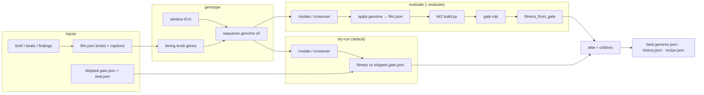
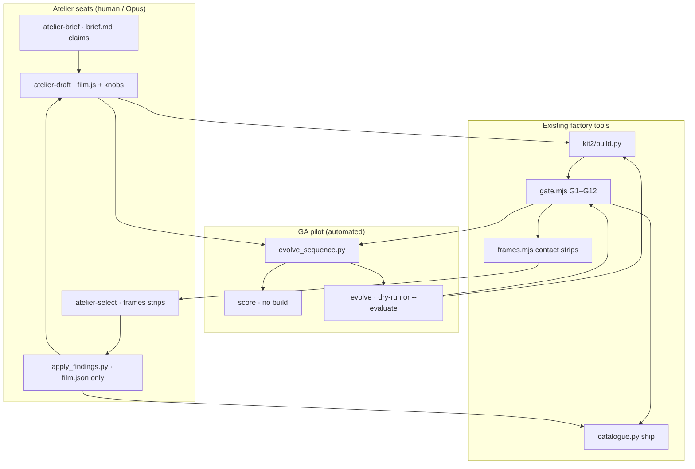

# Workflow · GA storyboard reward ↔ factory pipeline

How the pilot in `factory/tools/evolve_sequence.py` maps onto the explainer factory and Atelier seats.

## 1 · GA pipeline (bounded clock window)



**Fitness terms** (see `docs/GA-STORYBOARD-REWARD.md`):

- Weighted gate rows (FAIL → −∞; WARN → half credit).
- Anchor penalty on knob drift from shipped baseline.
- Findings alignment (knob time vs caption beat).
- Optional seat.json craft / truth / defects.

## 2 · Factory worker mapping (who does what)



| Atelier / factory step | GA pilot analogue |
|------------------------|-------------------|
| Draft knobs in `film.json` | Genotype `genes.knobs` |
| Blind select on strips | Fitness replaces pairwise preference (gate + seat + alignment) |
| `apply_findings.py` | Findings-aggregate seed genome + alignment penalty |
| Two tool-applied rounds | `--generations` / `--population` (offline; ship still via findings + NOTES) |
| Gate before ship | `--evaluate` runs full gate per individual |
| Seat.json | Soft term in fitness (not a hard gate) |

## 3 · Recommended proof commands (copy-paste)

```sh
# Baseline score only
python3 factory/tools/evolve_sequence.py score factory/films/simpsons-3d --window 36,58

# Fast GA logic check
python3 factory/tools/evolve_sequence.py evolve factory/films/simpsons-3d \
  --window 36,58 --population 4 --generations 2 --dry-run

# Full loop (WebGL ~2 min on this VM)
python3 factory/tools/evolve_sequence.py evolve factory/films/simpsons-3d \
  --window 36,58 --population 4 --generations 2 --evaluate

# Full loop (2D ledger ~30 s)
python3 factory/tools/evolve_sequence.py evolve factory/films/goodhart/drafts/ledger \
  --window 36,58 --population 4 --generations 2 --evaluate
```

Outputs land in `<film-dir>/evolve/`; this proof copies the simpsons artifacts into `docs/proofs/ga-storyboard-reward/`.
